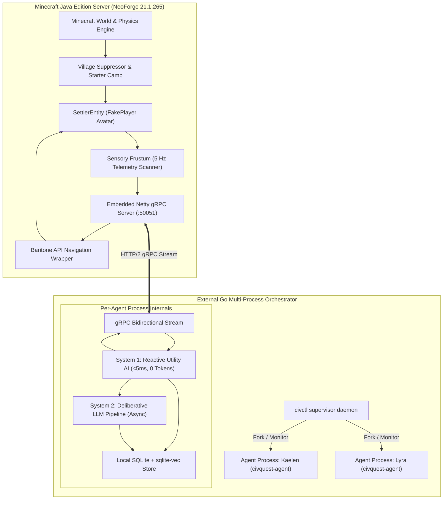

# Progressive Discovery: Architecture Overview

## 1. System Philosophy

CivQuest transforms Minecraft into a living, persistent civilization simulation. It rejects the primitive trading mechanics and artificial nature of vanilla Minecraft villagers, replacing them with autonomous, humanoid agents possessing:
- Individual identities, genealogies, and personality traits.
- Dual-career schedules (primary duty + secondary artisanal hobbies).
- Dynamic inter-clan relationships, trade caravans, and diplomacy.
- Spatial construction capabilities for building towns and defensive bastions.
- True permadeath with permanent generational consequences.

## 2. Component Breakdown

### Component 1: `mod-neoforge`
The server-side Minecraft mod acts as the sensory input organ and physical actuator. It does not perform high-level cognitive deliberation. Its responsibilities are:
1. **World Generation Interception**: Datapack override suppressing vanilla village structures, and event handlers canceling `Villager` and `WanderingTrader` entity spawns.
2. **`SettlerEntity`**: Subclassing `FakePlayer` to provide full player simulation (hunger ticking, item usage, combat knockback, equipment slots) for server-side autonomous agents.
3. **Sensory Frustum**: Gathering visible entities ($R = 24$), interesting blocks ($R = 16$), chat events, and damage frames at 5 Hz.
4. **Physical Actuation**: Executing navigation intents via Baritone, block interactions (harvesting, paving, sleeping), container transfers, signpost placement, and lectern book insertion.

### Component 2: `orchestrator-go`
The external Go orchestrator contains all cognitive, psychological, and civic logic:
1. **`civctl` Supervisor**: Spawns and monitors agent worker processes, oversees dynastic reproduction, and exposes administrative CLI commands.
2. **`civquest-agent`**: The single-agent runtime executing:
   - **System 1**: Immediate survival reflexes, fight-or-flight calculations, saturation management, and daily utility scheduling.
   - **System 2**: Asynchronous LLM interactions for dialogue, trade barter, book writing, and blueprint quadrant layout.
   - **Data Management**: Reading and mutating local SQLite databases (`memory.db`, `map_graph.db`) and clan-level databases (`civic_registry.db`, `diplomacy.db`, `reputation.db`).
