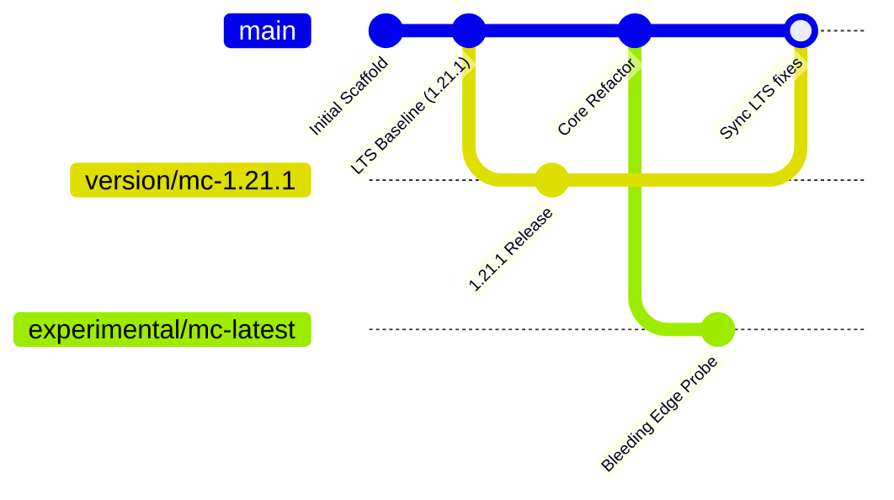

# Progressive Discovery: Versioning & Multi-Branch Release Strategy

## 1. Upstream Dynamics
Minecraft modding requires balancing two competing forces:
- **Ecosystem Breadth**: Mods like Baritone, Farmer's Delight, and Vinery have rich, battle-tested releases on stable LTS targets (specifically Minecraft 1.21.1 / NeoForge 21.1.265).
- **Upstream Evolution**: Mojang and NeoForge continuously release newer versions (e.g. 1.21.4, 21.4.x, 26.x).

Attempting to force bleeding-edge NeoForge builds as the sole target breaks essential pathfinding and agricultural dependencies. Conversely, freezing on an old version prevents taking advantage of future engine improvements.

## 2. Multi-Branch Versioning Model

### Branch Roles:
1. **`main` Trunk**:
   - Represents the active, primary stable release baseline (Minecraft 1.21.1 / NeoForge 21.1.265).
   - All standard PRs, beads task work, and ADRs are integrated here.
2. **Version Branches (`version/mc-<version>`)**:
   - Long-lived maintenance branches for specific Minecraft/NeoForge version pairs (e.g., `version/mc-1.21.1`, `version/mc-1.21.4`).
   - Allow targeted packaging and distribution for players on distinct Minecraft versions.
3. **Experimental Branches (`experimental/mc-latest`)**:
   - Tracks bleeding-edge NeoForge and Minecraft releases.
   - Used to probe API changes and prepare ports before upstream mods update.
4. **Backporting Discipline**:
   - Features implemented or refined on leading branches must be cherry-picked or backported into active stable version branches.
   - Core behavioral logic in `orchestrator-go` remains decoupled from Minecraft engine versions through the version-stable gRPC boundary.
