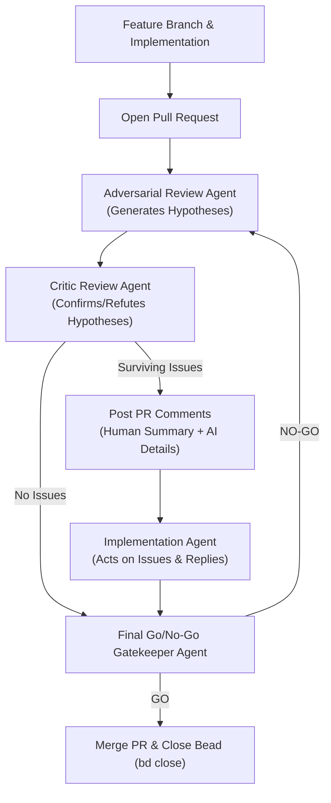

# Progressive Discovery: Adversarial Review & PR Lifecycle

## 1. Overview & Core Philosophy
To guarantee high code quality, security, and architectural integrity without manual operator fatigue, CivQuest employs an **Adversarial Multi-Agent Review Pipeline** for every pull request (PR).

Every bead implementation must pass through this lifecycle before merging:



## 2. Review Specialist Roles & Focus Areas
The review pipeline incorporates four specialist perspectives:

1. **DevSecOps Specialist**:
   - Least privilege and sandbox perimeter integrity.
   - Socket permissions, XDG path traversal prevention, and input sanitization.
   - Secret leakage and dependency vulnerability analysis.
2. **Architecture Specialist**:
   - Strict adherence to monorepo boundaries, ADRs, and project invariants.
   - Dual-tier separation: System 1 (<5ms, 0 tokens) vs. System 2 (asynchronous LLM).
   - Process-per-agent isolation and database transaction safety.
3. **Pragmatism & Simplicity Specialist (KISS)**:
   - Aggressive resistance to over-engineering, premature abstractions, and brittle complexity.
   - Prefer simple, idiomatic, and maintainable solutions over complex metaprogramming or deep inheritance.
4. **Reliability & Performance Specialist**:
   - Zero-allocation or low-allocation hot paths in 5 Hz telemetry and 20 Hz server tick loops.
   - Memory leak prevention, goroutine leak checks, and gRPC connection resiliency.

## 3. Step-by-Step Execution Protocol

### Step 1: Implementation & PR Creation
- The implementation agent claims the bead (`bd update <id> --claim`), creates a feature branch (`feat/<bead-id>-<slug>`), writes the code, verifies builds and tests, and opens a GitHub PR.

### Step 2: Adversarial Hypothesis Formulation
- An **Adversarial Review Agent** inspects the full diff against `main`.
- Rather than asserting subjective opinions, it frames potential issues as testable **hypotheses** (e.g., *"Hypothesis: Unbounded buffered channel in telemetry dispatcher may cause memory exhaustion under network disconnects"*).

### Step 3: Critic Confirmation Gate
- A distinct **Critic Agent** independently analyzes each hypothesis against the code, tests, and specification to either **CONFIRM** (with concrete evidence or failure scenario) or **REFUTE** (demonstrating why existing guards mitigate it).

### Step 4: Structured PR Commenting
- Only hypotheses that survive critic confirmation are posted as PR comments using this format:
  ```markdown
  ### [SEV: HIGH|MED|LOW] [SPECIALTY] <Concise 1-2 sentence issue summary for human scanning>

  <details>
  <summary>AI Remediation Prompt & Reproduction Context</summary>

  **Hypothesis Confirmed**: <Explanation of failure mechanism or violation>
  **Affected Files / Lines**: `<file>#L<line>`
  **Action Required for Implementation Agent**:
  ```prompt
  Refactor the component to...
  Ensure test coverage verifies...
  ```
  </details>
  ```

### Step 5: Implementation Remediation & Response
- The implementation agent addresses each comment, updates code and tests, pushes amendments to the feature branch, and replies directly to the PR comment explaining the exact remediation applied.

### Step 6: Final Go/No-Go Signal
- A **Final Review Agent** verifies all comments have been addressed, runs CI checks, and renders a definitive **GO** or **NO-GO** signal.
  - If **GO**: PR is merged to `main`, beads task is completed (`bd close <id>`), and beads state is synced (`bd dolt push`).
  - If **NO-GO**: The cycle repeats with specific blocking criteria.
