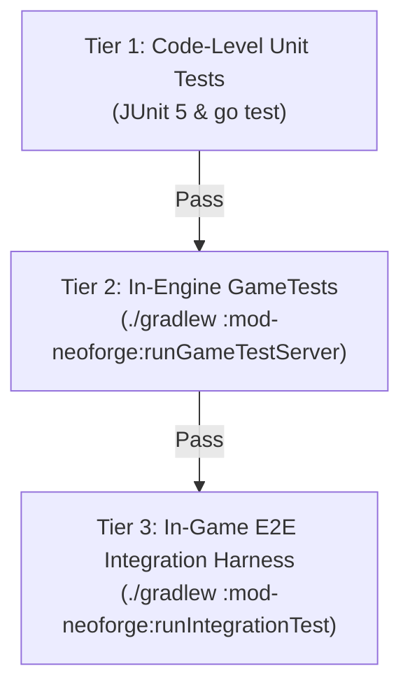

# Progressive Discovery: In-Game Integration Test Harness

## 1. Overview & Verification Strategy
CivQuest implements a **Three-Tier Verification Architecture** to guarantee reliability across both Java and Go codebases without slow or brittle test runs:



- **Tier 1 (Unit)**: Millisecond-level tests mocking external dependencies.
- **Tier 2 (GameTest)**: Native NeoForge in-engine tests validating internal Java mechanics directly on the server tick thread without external processes.
- **Tier 3 (E2E Integration)**: Headless dedicated server paired with a real Go integration probe validating live IPC, FakePlayer spawning, 5 Hz telemetry streaming, and Baritone actuation.

---

## 2. Tier 2: NeoForge GameTest Setup

NeoForge 1.21.1 provides native headless GameTest execution via ModDevGradle (`net.neoforged.moddev`).

### Gradle Configuration (`mod-neoforge/build.gradle`)
```groovy
neoForge {
    version = project.loaderVersion

    runs {
        gameTestServer {
            type = "gameTestServer"
            systemProperty 'neoforge.enabledGameTestNamespaces', 'civquest'
        }
    }
}
```

### Writing a GameTest
GameTests use `net.minecraft.gametest.framework.GameTest` and NeoForge's `EmptyTemplate`:
```java
package com.civquest.mod.gametest;

import net.minecraft.core.BlockPos;
import net.minecraft.gametest.framework.GameTest;
import net.minecraft.gametest.framework.GameTestHelper;
import net.neoforged.testframework.gametest.EmptyTemplate;

public class SettlerSpawnGameTest {

    @GameTest(template = "neoforge:empty3x3x3")
    public static void testSettlerLifecycle(GameTestHelper helper) {
        // Assert server level is active and valid
        helper.assertBlockPresent(net.minecraft.world.level.block.Blocks.AIR, new BlockPos(1, 1, 1));
        helper.succeed();
    }
}
```

Run via:
```bash
./gradlew :mod-neoforge:runGameTestServer
```

---

## 3. Tier 3: In-Game E2E Integration Harness

### Server Automation Configuration
The harness launches a headless dedicated Minecraft server into an isolated sandbox (`build/integration-test/`) with tuned flags:
- `level-type=minecraft:flat`: Bypasses complex terrain generation, reducing chunk loading from 35s to <2s.
- `pause-when-empty-seconds=-1`: Ensures server ticks at 20 Hz even when no human client is connected.
- `max-tick-time=-1`: Disables the watchdog crash thread.
- `online-mode=false` & `sync-chunk-writes=false`: Optimizes IO and network overhead.

### Dynamic Port Discovery (`civquest-server-meta.json`)
The mod binds its embedded Netty gRPC server to an ephemeral port (`-Dcivquest.grpc.bind=127.0.0.1:0`). When bound, it writes discovery metadata:
```json
{
  "status": "READY",
  "grpc_transport": "tcp",
  "grpc_port": 54321,
  "grpc_host": "127.0.0.1",
  "server_pid": 12845
}
```

### Go Synthetic Probe (`orchestrator-go/test/integration/live_server_test.go`)
The Go test probe connects via gRPC, verifies health, and exercises the contract:
```go
//go:build integration

package integration

import (
	"context"
	"testing"
	"time"

	civquestv1 "github.com/btposey/civquest/orchestrator-go/internal/proto/v1"
	"google.golang.org/grpc"
	"google.golang.org/grpc/health/grpc_health_v1"
)

func TestLiveServerEndToEnd(t *testing.T) {
	meta := ReadServerMeta(t)
	conn, err := grpc.Dial(meta.Addr(), grpc.WithInsecure())
	if err != nil {
		t.Fatalf("Failed to connect to CivQuest mod: %v", err)
	}
	defer conn.Close()

	// 1. Health check
	healthClient := grpc_health_v1.NewHealthClient(conn)
	resp, err := healthClient.Check(context.Background(), &grpc_health_v1.HealthCheckRequest{})
	if err != nil || resp.Status != grpc_health_v1.HealthCheckResponse_SERVING {
		t.Fatalf("gRPC health check failed: %v", err)
	}

	// 2. Spawn settler entity
	client := civquestv1.NewCivQuestBridgeServiceClient(conn)
	spawnResp, err := client.SpawnAgentEntity(context.Background(), &civquestv1.SpawnAgentRequest{
		AgentId:     "probe-settler-1",
		DisplayName: "ProbeSettler",
		ClanId:      "clan-test",
		SpawnCoords: &civquestv1.Vec3{X: 0, Y: 4, Z: 0},
	})
	if err != nil || !spawnResp.GetSuccess() {
		t.Fatalf("SpawnAgentEntity failed: %v", err)
	}

	// 3. Telemetry Stream verification (5 Hz)
	stream, err := client.ConnectAgent(context.Background())
	if err != nil {
		t.Fatalf("ConnectAgent stream failed: %v", err)
	}
	frame, err := stream.Recv()
	if err != nil {
		t.Fatalf("Failed to receive first telemetry frame: %v", err)
	}
	if frame.GetStatus().GetHealth() <= 0 {
		t.Fatalf("Unexpected health value: %v", frame.GetStatus().GetHealth())
	}

	// 4. Clean despawn
	despawnResp, err := client.DespawnAgentEntity(context.Background(), &civquestv1.DespawnAgentRequest{
		AgentId: "probe-settler-1",
	})
	if err != nil || !despawnResp.GetSuccess() {
		t.Fatalf("DespawnAgentEntity failed: %v", err)
	}
}
```

### Clean Teardown Protocol
The harness terminates the server gracefully:
1. Writes `stop\n` to stdin of the server process.
2. Waits up to 15 seconds for process termination.
3. Fallbacks to `SIGTERM` and `SIGKILL` if unresponsive.
4. Asserts exit code `0` and releases file locks.
