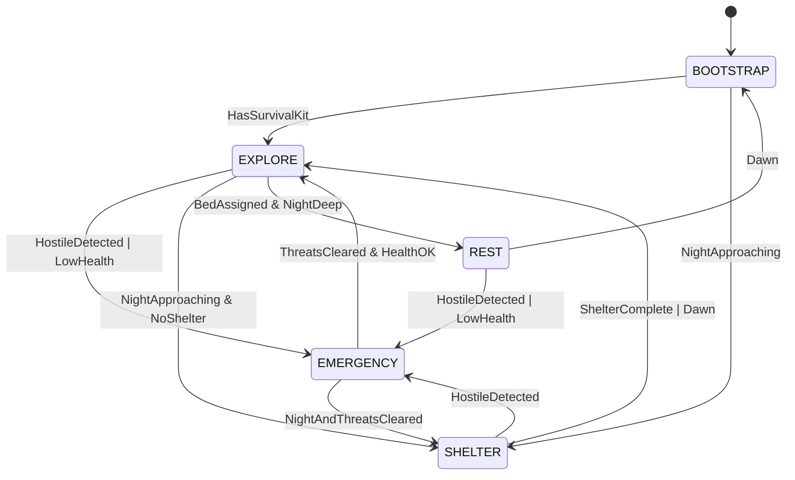
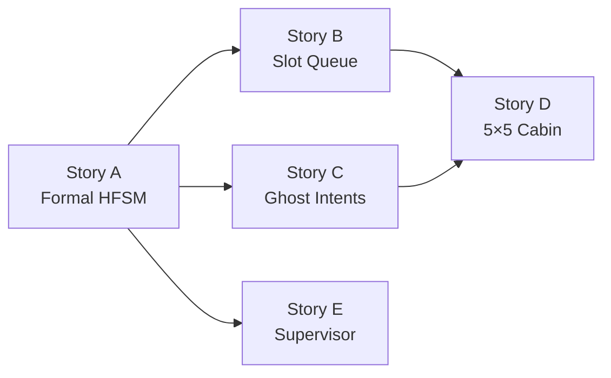

# CivQuest Re-Evaluation: FSM Design, Ghost Intents & Intent Deduplication

> [!IMPORTANT]
> This document supersedes prior task plans. No code is changed until the user approves this design.

---

## 1. Do We Have a Proper FSM? No.

### What We Currently Have

The current architecture is **not a formal FSM**. It is an ad-hoc priority-cascade evaluator:

```
Every telemetry frame (5 Hz):
  if hostiles → EvaluateReflexes()     ← EMERGENCY override
  if panic    → return early
  EvaluateUtility()                    ← computes "current routine" string
  EvaluateBiologicalNeeds()            ← hunger/sleep checks
  EvaluatePaving()                     ← road laying
  EvaluateExploration()                ← movement/shelter/terrain
```

This is a layered priority stack, NOT a state machine. There is **no formal state graph** with:
- Defined states
- Explicit allowed transitions
- Entry/exit actions
- Guards that prevent illegal transitions
- A single source of truth for "what state am I in right now?"

### What Makes It Brittle

| Brittleness | Evidence |
|---|---|
| **No transition guards** | EMERGENCY → SLEEP transition fires immediately when `time_of_day >= 23000`, even mid-combat (observed in debug log at tick 167015: `EMERGENCY → SLEEP`) |
| **No entry/exit hooks** | When entering EMERGENCY, no cleanup of pending non-combat intents queued from prior exploration; they race with panic intents |
| **Competing evaluators write to the same intent queue** | `EvaluateBiologicalNeeds` and `EvaluateExploration` can both queue NavigateIntents in the same frame; whichever is dispatched first "wins" non-deterministically |
| **State stored in multiple places** | `AgentState.CurrentRoutine`, `runtime.lastLoggedRoutine`, `system1State.shelterBlocksPlaced`, `system1State.lastExploreTick` — no single authority |
| **No stuck-state detection** | If the FSM reaches a goal (e.g. GATHER_TIMBER) but the resource is unreachable, there's no timeout or fallback transition; the agent freezes (observed: "standing in one place") |
| **Goal transitions are purely cosmetic** | `GOAL_TRANSITION` log entries are for observability only; the actual behavior doesn't change because the goals don't gate the evaluators |

### What a Proper FSM Looks Like

A formal **Hierarchical FSM (HFSM)** for System 1 should have these top-level states:



Each state owns:
- **Guard function** — conditions that must be true to remain in this state
- **Entry action** — what intents to queue/clear on entry
- **Tick action** — what evaluator to call each frame while in state
- **Exit action** — cleanup when leaving (e.g. drain non-priority queue, reset cooldowns)
- **Transition table** — explicit next-state rules evaluated in priority order

---

## 2. Ghost Intents: Raising a Non-Existent Shield

### What We Confirmed

The debug log shows Able producing **50+ consecutive `AttackIntent(shield=true, flee=true)`** at ~5 Hz:

```
AttackIntent(target=1637,shield=true,flee=true) seq=484
AttackIntent(target=1637,shield=true,flee=true) seq=485
...
AttackIntent(target=1735,shield=true,flee=true) seq=528
```

In `IntentActuator.java` (lines 183–202), `actuateAttack()` does handle absence gracefully:
- If `raise_shield=true` AND agent has `Items.SHIELD` in offhand or inventory → it blocks.
- If no shield exists → `// do NOT create one` (comment at line 202) → the shield raise **silently no-ops**.

### The Problem

**`confidence.go` unconditionally sets `RaiseShield: true` during flee mode** regardless of whether Able has a shield in inventory. `CalculateGearMultiplier()` does check `hasShield` for the confidence score, but the resulting `AttackIntent` is emitted with `RaiseShield: true` regardless:

1. **Able is told to raise a shield she doesn't have** — the Java side silently ignores it, but the intent still crosses the gRPC stream.
2. **50+ AttackIntents flood the gRPC queue per combat encounter** — each one is processed server-side, causing the backpressure death spiral.
3. **The flee NavigateIntent is re-queued every ~2–3 ticks** because `skipFleeNav` only guards within 10 ticks of an identical target. As the navigation singularity fires and the agent spins, `lastFleeTarget` diverges from `combatResult.FleeTarget` and the dedup threshold is missed.

### The Fix Required

`EvaluateReflexes` must **query the inventory snapshot before deciding to raise a shield**:

```go
// In ReflexContext, add:
HasShield bool  // pre-computed from inventory scan
HasWeapon bool
WeaponSlot int32

// In confidence.go flee branch:
attackIntent.RaiseShield = ctx.HasShield  // only raise if actually equipped
```

Additionally, `runtime.go` must populate `HasShield` from `frame.InventoryItems` before calling `EvaluateReflexes`.

---

## 3. Intent Deduplication: Your Proposal Is Sound — With One Key Nuance

### Your Proposal
> *"The same intent cannot enter the queue until an existing intent of the same type has been processed."*

This is called **intent coalescing** (typed slot queue), and it is the right approach.

### Current Queue Model

```go
intentQueue chan *civquestv1.AgentIntent   // fixed-size buffered channel
```

There is **no deduplication**. During a 5 Hz combat panic, over 60 seconds of combat:
- ~75 AttackIntents queued
- ~30 NavigateIntents queued

With gRPC backpressure never draining fast enough, sequence numbers 482–528 pile up and saturate the stream.

### The Deduplication Design (Typed Slot Queue)

A fixed-capacity map of `intentType → *AgentIntent` with FIFO ordering:

```
SlotQueue:
  SLOT[navigate]   → one pending NavigateIntent    (new overwrites old)
  SLOT[attack]     → one pending AttackIntent       (new overwrites old)
  SLOT[use_item]   → one pending UseItemIntent      (new overwrites old)
  SLOT[craft]      → one pending CraftItemIntent    (new overwrites old)
  SLOT[interact]   → one pending InteractBlockIntent(new overwrites old)
  SLOT[place_block]→ ⚠️ EXCEPTION — see below
```

Dispatch order: priority slots first, then FIFO insertion order within priority tier.

### Does This Violate Any Design Invariants?

| ADR | Concern | Impact of Dedup |
|---|---|---|
| ADR-003 (Bidirectional gRPC) | "Stream must remain responsive" | ✅ Directly reduces backpressure |
| ADR-005 (System 1 < 5ms) | Slot map lookup is O(1) | ✅ No timing impact |
| ADR-004 (Process isolation) | Queue is per-process | ✅ Not affected |
| ADR-009 (Baritone pathfinding) | NavigateIntent triggers Baritone path computation | ✅ Coalescing IMPROVES Baritone path churn; only the latest flee target matters |

### ⚠️ PlaceBlock Must Bypass the Slot Queue

Shelter construction is a **sequence** of block placements that must happen in spatial order. Coalescing PlaceBlockIntents to a single slot would **break construction sequencing** (e.g. wall block overwrites floor block).

**Solution:** PlaceBlockIntents bypass the slot queue and use a dedicated ordered `[]PlaceBlockIntent` construction pipeline with its own 4-tick rate limiter and sequence index tracking.

---

## 4. Revised Task Plan (5 Stories)

### Story A — Formal Hierarchical FSM (Foundation — Must Go First)

**What:** Replace the ad-hoc priority cascade in `runtime.go:processFrame()` with a proper HFSM.

**States:** `BOOTSTRAP`, `EXPLORE`, `SHELTER`, `EMERGENCY`, `REST`

**Files:**
- **New:** `orchestrator-go/internal/system1/fsm.go` — `AgentFSM` struct with `Tick(frame)`, `TransitionTo(state)`, `CurrentState()`, guard/entry/exit/tick hooks per state
- **New:** `orchestrator-go/internal/system1/fsm_test.go` — transition table tests, guard tests, concurrent safety (including `EMERGENCY → SLEEP` guard test)
- **Mod:** `orchestrator-go/internal/agent/runtime.go` — replace flat `processFrame()` with `agentFSM.Tick(frame)` dispatch

**Benefits:** Eliminates mid-combat `EMERGENCY → SLEEP` jump. Eliminates competing evaluator race conditions. Provides the guardrails that make all future work testable and observable.

---

### Story B — Intent Slot Queue with Typed Deduplication

**What:** Replace `chan *AgentIntent` with a `SlotQueue` that enforces one-pending-per-intent-type.

**Files:**
- **New:** `orchestrator-go/internal/agent/slotqueue.go` — `SlotQueue` struct with `Put(priority, intent)`, `Drain() []*AgentIntent`, slot map keyed by `intentType`
- **New:** `orchestrator-go/internal/agent/slotqueue_test.go` — overwrite semantics, priority ordering, PlaceBlock passthrough, concurrent safety
- **Mod:** `orchestrator-go/internal/agent/runtime.go` — replace `intentQueue chan` with `SlotQueue`; drain goroutine reads from `SlotQueue` on tick cadence

**PlaceBlock exception:** PlaceBlockIntents bypass the slot queue and are managed by an ordered `[]PlaceBlockIntent` construction pipeline with a 4-tick rate limiter.

---

### Story C — Ghost Intent Guards (Inventory-Aware Combat Reflexes)

**What:** Add `HasShield bool`, `HasWeapon bool`, `WeaponSlot int32` to `ReflexContext`. Gate `RaiseShield` and attack type on actual inventory state.

**Files:**
- **Mod:** `orchestrator-go/internal/system1/confidence.go` — `EvaluateReflexes(ctx)` gates `RaiseShield` on `ctx.HasShield`; tactical counter-attack when mob is within 2.5 blocks and `ctx.HasWeapon`
- **Mod:** `orchestrator-go/internal/agent/runtime.go` — populate `HasShield`, `HasWeapon`, `WeaponSlot` from `frame.InventoryItems` before calling `EvaluateReflexes`
- **Mod:** `orchestrator-go/internal/system1/confidence_test.go` — add `TestNoShieldRaiseWithoutShield`, `TestCounterAttackWhenInMeleeRange`

---

### Story D — 5×5 Frontier Cabin Blueprint (Depends on A + B)

**What:** Replace the 8-block emergency barricade with a phased 5×5 exterior / 3×3 interior cabin with door, roof, and torch. Requires the FSM (A) to properly gate shelter state and the slot queue (B) to handle PlaceBlock pipeline sequencing correctly.

**Files:**
- **New:** `orchestrator-go/internal/blueprints/frontier_cabin.go` — blueprint definition as a reusable `BlueprintSpec` struct
- **Mod:** `orchestrator-go/internal/system1/exploration.go` — rewrite `evaluateDuskNightOutpostShelterLocked` to use phased build sequence via `PlaceBlockIntent` pipeline: (1) clear 5×5 footprint, (2) lay floor, (3) raise 3-high perimeter walls, (4) place door frame + `oak_door`, (5) roof slabs, (6) interior torch
- **Mod:** `exploration_test.go` — add shelter geometry assertion tests

---

### Story E — Process Stability & Supervisor Keep-Alive

**What:** Ensure `cq` supervisor monitors child PIDs and reconnects the gRPC stream if the agent process exits without a death event.

**Files:**
- **Mod:** `orchestrator-go/cmd/cq/agent.go` — add `--restart-on-exit` flag and watchdog goroutine
- **Mod:** `orchestrator-go/internal/launcher/launcher.go` — expose `ProcessExited()` channel for supervisor polling

---

## 5. Dependency Order



Story A is the unblocking foundation. B and C are independent once A is done. D depends on both B and C. E is independent.

---

## 6. Test Coverage Gaps (New + Existing)

| Gap | Severity | Story |
|---|---|---|
| No FSM state transition table test | 🔴 High | A |
| No test: `EMERGENCY → SLEEP` blocked mid-combat | 🔴 High | A |
| No test: `RaiseShield=false` when no shield in inventory | 🔴 High | C |
| No test: counter-attack fires when mob within melee range with weapon | 🔴 High | C |
| No slot queue overwrite semantics test | 🟡 Med | B |
| No test: PlaceBlock bypasses slot and preserves sequence order | 🟡 Med | B + D |
| No construction sequence integrity test (5×5 spatial order) | 🟡 Med | D |
| No supervisor watchdog restart test | 🟡 Med | E |
| No integration test: zombie encounter → flee → backpressure stays bounded | 🟡 Med | B + C |
